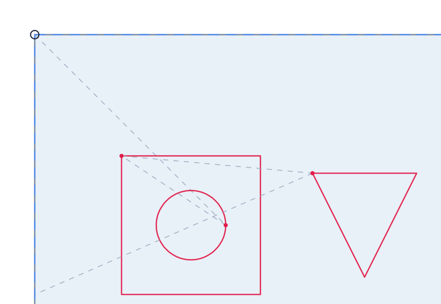

# BladePilot

<p>
  
  <a href="https://github.com/TechnikWeber/BladePilot/releases"></a>
  <a href="https://github.com/TechnikWeber/BladePilot/releases"></a>
  <a href="https://github.com/TechnikWeber/BladePilot/actions/workflows/ci.yml"></a>
  
  <a href="LICENSE"></a>
</p>

<p>
  <a href="https://github.com/TechnikWeber/BladePilot/releases"><b>Download</b></a> &nbsp;·&nbsp;
  <a href="#download"><b>Install</b></a> &nbsp;·&nbsp;
  <a href="docs/ROADMAP.md"><b>Roadmap</b></a> &nbsp;·&nbsp;
  <a href="docs/ARCHITECTURE.md"><b>How it works</b></a> &nbsp;·&nbsp;
  <a href="docs/HARDWARE-DAY.md"><b>Hardware test day</b></a>
</p>

Cut on Silhouette Portrait and Cameo machines from Linux: open SVG and Silhouette Studio
files (`.studio3`), place them on the mat and cut. A free, independent alternative to the
vendor software for the machines you own, written in Rust.

> **Early development.** The whole chain runs against a virtual plotter. Cutting on a real
> machine has not been tested yet; when it is, start with a pen on paper.



## What works today

- **Open designs:** SVG (text becomes outlines) and Silhouette Studio `.studio` / `.studio3`
  files (outlines, line colours, page size). Store designs with copy protection are refused,
  never decrypted.
- **Plan the job:** one pass, or one pass per colour with its own force, speed, depth and
  repeats. Pens draw before blades cut, holes are cut before the shape around them, and the
  head takes the nearest next start.
- **Write the machine program** in the Silhouette dialect of GP-GL, using
  [`craft-plotter`](https://github.com/storytold/craft-libs/tree/main/crates/plotter).
- **Virtual plotter:** answers status, version and tool queries like a machine, records every
  cut, warns about anything outside the cutting area and draws the job as SVG.
- **Command line:** `machines`, `devices`, `inspect`, `cut --dry-run`, `cut --simulate`, and
  `replay` for USB captures made with Wireshark.
- **USB:** finds connected machines. Sending is written for Linux, macOS and Windows (there
  through the same driver Silhouette Studio uses) and waits for its first hardware test.

The desktop app with a mat view, print and cut, and more import formats are next: see the
[roadmap](docs/ROADMAP.md).

## Download

Pick the file for your system from the [releases](https://github.com/TechnikWeber/BladePilot/releases):

| System | File | Start |
|---|---|---|
| Any Linux | `BladePilot-…-x86_64.AppImage` (or `aarch64`) | `chmod +x BladePilot-*.AppImage`, then run it |
| Fedora, openSUSE | `bladepilot-….x86_64.rpm` | `sudo dnf install ./bladepilot-*.rpm` |
| Debian, Ubuntu, Raspberry Pi OS | `bladepilot_…_amd64.deb` (or `arm64`) | `sudo apt install ./bladepilot_*.deb` |
| Windows | `BladePilot-…-windows-x86_64.exe` (or `arm64`) | run it from a terminal |
| macOS | `BladePilot-…-macos-universal.tar.gz` | unpack, `xattr -d com.apple.quarantine bladepilot` |

The `.rpm` and `.deb` also install the udev rule that gives you access to the machine over USB.
Windows and macOS warn about an unknown developer, because the files are not signed.

Then, in a terminal:

```sh
bladepilot cut my-design.svg --simulate preview.svg
```

That plans the cut, runs it on the virtual plotter and draws the result into `preview.svg`.
`bladepilot inspect FILE` shows what a design contains, `bladepilot cut FILE --dry-run` prints
the commands a machine would receive, and `bladepilot machines` lists the supported machines.

### Build from source

With [Rust](https://rustup.rs) 1.95 or newer: `cargo run -p bladepilot-cli -- --help`.

## Supported machines

| Machine | USB id | Status |
|---|---|---|
| Silhouette Portrait 3 | `0b4d:113a` | development target |
| Silhouette Portrait 4 | `0b4d:113f` | development target |
| Portrait 1 and 2, Cameo 1 to 5 (Plus, Pro), Cameo Pro MK II, Cameo 5 Alpha, Craft Robo CC200 | | known, not tested |

`bladepilot machines` prints the full table with cutting widths and mats.

## How it is built

BladePilot is written from public documentation, community notes and observation of the
machines and their files. It contains no vendor code, assets or data, and reverse-engineering
material never enters this repository. The rules are in [docs/CLEAN-ROOM.md](docs/CLEAN-ROOM.md),
the protocol as BladePilot understands it in [docs/PROTOCOL.md](docs/PROTOCOL.md).

## Related projects

- [craft-libs](https://github.com/storytold/craft-libs): `craft-plotter` and
  `craft-silhouette-studio`, the building blocks BladePilot uses (MIT OR Apache-2.0)
- [inkscape-silhouette](https://github.com/fablabnbg/inkscape-silhouette): Inkscape extension
  for the same machines, with the community's device notes
- [cuthulhu](https://github.com/vcolombo/cuthulhu): another Rust cutting app, GPL-3.0
- [studio3svg](https://github.com/zaydmulani09/studio3svg): converts `.studio3` files to SVG
- [py_silhouette](https://github.com/mossblaser/py_silhouette) and
  [robocut](https://github.com/alpharesearch/robocut): earlier drivers

## Trademarks

Silhouette, Silhouette Studio, Cameo, Portrait and Curio are trademarks of Silhouette America,
Inc.; Graphtec and Craft Robo of Graphtec Corporation. BladePilot is an independent project and
is not affiliated with, endorsed or sponsored by either. The names only say which machines it
works with.

## License

[MIT](LICENSE). The crates BladePilot builds on keep their own licenses.
